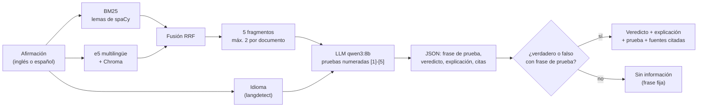

# Fact-checking de mitología griega, romana y nórdica

Proyecto final de **Procesamiento del Lenguaje Natural** (Máster en Inteligencia Artificial Aplicada, UC3M).

Sistema de **verificación de hechos** basado en RAG (*Retrieval-Augmented Generation*) sobre mitología griega, romana (las versiones romanas de los mitos griegos, como las de Ovidio) y nórdica. Dada una afirmación, en inglés o en español ("Zeus se tragó a sus hijos", "Thor es hijo de Loki"), el sistema busca pruebas en un corpus de unos 5.000 textos descargados e indexados previamente, y un LLM de pesos abiertos responde con un veredicto, una explicación breve en el idioma de la afirmación y las fuentes que lo prueban:

- **Verdadero** / **Falso**: un fragmento de las fuentes confirma o desmiente la afirmación, y se cita.
- **Sin información**: las fuentes no permiten confirmarla ni desmentirla. El sistema no responde con lo que "sabe" el LLM: solo afirma lo que puede citar.
- **Depende de la fuente** (previsto para el Hito 3 o la entrega final): distintos autores cuentan versiones distintas del mito.

Dos rasgos propios del tema:

- **Equivalencias de nombres** entre mitologías y traducciones: Zeus = Júpiter = Jove, Odiseo = Ulises, Heracles = Hércules… Las traducciones antiguas de los clásicos usan los nombres romanos incluso para los mitos griegos.
- **Tipos de fuente**: cada fragmento sabe si viene de una fuente **primaria** (textos clásicos), **enciclopédica** (Wikipedia) o **divulgativa** (artículos y vídeos), y los vídeos de YouTube además si son de nivel **experto** o **popular**. Esto permite citar con precisión y estudiar cómo afecta el tipo de fuente a la cobertura y a los errores.

**En una frase, cómo va el proyecto**: el sistema completo funciona (búsqueda híbrida BM25 + *embeddings* multilingües y `qwen3:8b` como LLM) y acierta el **82 %** de 250 afirmaciones de evaluación revisadas a mano; su punto débil es la búsqueda con afirmaciones en español (secciones 11 a 13).

---

## Índice

1. [Estado y calendario](#1-estado-y-calendario)
2. [Cómo funciona el sistema](#2-cómo-funciona-el-sistema)
3. [Estructura del repositorio](#3-estructura-del-repositorio)
4. [Instalación](#4-instalación)
5. [El corpus](#5-el-corpus)
6. [Cómo se construye todo, paso a paso](#6-cómo-se-construye-todo-paso-a-paso)
7. [Formato de los datos](#7-formato-de-los-datos)
8. [Preprocesado](#8-preprocesado)
9. [Queries de evaluación](#9-queries-de-evaluación)
10. [Hito 1: baseline de recuperación](#10-hito-1-baseline-de-recuperación)
11. [Hito 2: recuperación densa e híbrida](#11-hito-2-recuperación-densa-e-híbrida)
12. [Hito 2: el verificador (generación)](#12-hito-2-el-verificador-generación)
13. [Hito 2: evaluación de la generación](#13-hito-2-evaluación-de-la-generación)
14. [Limitaciones conocidas y mejoras pendientes](#14-limitaciones-conocidas-y-mejoras-pendientes)
15. [Licencias de las fuentes y de los modelos](#15-licencias-de-las-fuentes-y-de-los-modelos)
16. [Uso de herramientas de IA generativa](#16-uso-de-herramientas-de-ia-generativa)

---

## 1. Estado y calendario

| Fecha | Entrega | Estado |
|---|---|---|
| Lun 16 nov, 23:59 | Grupo, aplicación y repositorio en Aula Global | Hecho |
| Jue 19 nov, 23:59 | **Hito 1**: corpus, preprocesado y baselines TF-IDF y BM25 | Entregado: rama `main`, resumen en `MILESTONE_1.md` |
| Vie 4 dic, 23:59 | **Hito 2**: sistema RAG con LLM de pesos abiertos y base de datos vectorial | Hecho en la rama `desarrollo`: recuperación densa e híbrida, verificador y evaluación en `notebooks/hito2.ipynb`. Falta el resumen `MILESTONE_2.md` y llevarlo a `main` |
| Vie 18 dic, 23:59 | **Hito 3**: extensión (modelado de tópicos o LoRA/QLoRA) | — |
| Enero | Entrega final (informe y código) y presentación | — |

Los hitos se corrigen sobre la rama **`main`** en el commit indicado en Aula Global. El trabajo se hace en la rama **`desarrollo`** y se lleva a `main` en cada entrega (`git merge --ff-only desarrollo` o un *pull request*).

**Cada hito tiene su notebook**, ejecutado y con sus conclusiones: `notebooks/hito1.ipynb` (corpus, queries y baselines) y `notebooks/hito2.ipynb` (recuperación densa e híbrida, verificador y su evaluación). Los scripts de `src/` hacen lo lento o lo que se hace una sola vez (descargas, corpus, índice vectorial, generación de queries y afirmaciones); los notebooks cargan su resultado, lo explican y lo analizan.

---

## 2. Cómo funciona el sistema



Paso a paso:

| Paso | Qué hace | Por qué | Dónde (sección de `hito2.ipynb`) |
|---|---|---|---|
| 1. Búsqueda léxica | **BM25** (`bm25s`, Lucene, k1 = 1,5, b = 0,75) sobre los lemas de spaCy, con el título del documento delante de cada fragmento | Acierta con nombres raros y exactos (*opuntii*) | §1.1 (y el Hito 1) |
| 2. Búsqueda densa | **`intfloat/multilingual-e5-base`**: un *embedding* por fragmento, guardado en **Chroma** con los datos para citar | Relaciona textos con palabras distintas y el mismo sentido (*islands of the blessed* / *Fortunate Isles*), y entiende afirmaciones en español | §1.2-1.4; el índice se crea con `src/indexa_vectores.py` |
| 3. Fusión | **Reciprocal Rank Fusion** (c = 60) de los fragmentos de los dos métodos | BM25 y e5 fallan en queries distintas; juntos colocan mejor el documento correcto (MRR 0,729 frente a 0,645) | §1.5-1.6 |
| 4. Pruebas | Los **5 mejores fragmentos**, como mucho 2 del mismo documento | Que las pruebas no salgan todas de un solo texto | §2.1 |
| 5. Idioma | `langdetect` decide si la afirmación está en español o en inglés | El LLM escribe la explicación en ese idioma | §2.1 |
| 6. Veredicto | **`qwen3:8b`** (servidor de la UC3M), temperatura 0. Debe copiar primero la frase de los fragmentos que prueba el dato y después dar el veredicto, una explicación y los números de los fragmentos citados, en JSON | Que el veredicto se apoye en una prueba concreta; el JSON permite evaluarlo automáticamente | §2.1-2.3 |
| 7. Regla final | Si dice *verdadero* o *falso* pero no copia ninguna frase de prueba, el veredicto pasa a *sin información* | El sistema solo afirma lo que puede citar | §2.3 |
| 8. Respuesta | Veredicto, explicación, frase de prueba y fuentes citadas (título, fuente, sección, URL, segundo exacto en los vídeos y el principio del fragmento). Si no hay información, una frase fija | Citar fuente y fragmento; no rellenar con lo que sabe el LLM | §2.1 |

**Ejemplos de respuesta** (reales, de la evaluación con `qwen3:8b`):

```
Afirmación: Opus I, rey de los epeos, fue hijo de Poseidón y de Protogenia, hija de Deucalión.
Veredicto: FALSO
La afirmación es falsa porque el pasaje indica que Opus I fue hijo de Zeus y no de Poseidón.
Prueba: «Opus I, king of the Epeians and son of Zeus by Protogeneia, daughter of Deucalion.»

Fuentes:
  [1] Opus (mythology) (Wikipedia) https://en.wikipedia.org/wiki/Opus_(mythology)
      «In Greek mythology, Opus (Ancient Greek: Ὀπόεις) may refer to the following characters: Opus
      I, king of the Epeians and son of Zeus by Protogeneia, daughter of Deucalion. Opus was the
      father of Cambyse or Protogeneia who was carried off by Zeus to Mt. Maenalus in Arcadia where
      she bore…»
```

```
Afirmación: Aquiles solía practicar el tiro con arco en el bosque sagrado de Melantea con su compañero Calias.
Veredicto: SIN INFORMACIÓN
No he encontrado información en las fuentes para confirmar o desmentir esta afirmación.
```

La afirmación en español se busca tal cual en un corpus en inglés: e5 es multilingüe, y BM25 aprovecha los nombres propios. La prueba y las fuentes se muestran en inglés, que es el idioma del corpus.

**Cómo probarlo con una afirmación propia.** De momento el verificador vive en el notebook del Hito 2. Con el entorno instalado (sección 4), los datos y la base vectorial construidos (sección 6) y el `.env` con la clave de la UC3M, se ejecutan las secciones 1 y 2 de `notebooks/hito2.ipynb` y después, en una celda nueva:

```python
r = verificar("Thor es hijo de Loki", modelo='qwen3:8b', prompt_base=PROMPT_V2)
print(formatea(r))
```

Hay que pasar el modelo y el prompt finales a mano: los valores por defecto de `verificar` (`llama3.1:8b` y el primer prompt) son los de las primeras pruebas de la sección 2. Pasar el verificador a un módulo de `src/` con la configuración final está entre las mejoras pendientes (sección 14).

---

## 3. Estructura del repositorio

```
Fact-checking_system/
├── README.md
├── MILESTONE_1.md            # resumen de la entrega del Hito 1
├── MILESTONE_2.md            # resumen de la entrega del Hito 2
├── requirements.txt
├── .gitignore
├── .env                      # NO se sube: clave de la API del LLM de la UC3M
├── src/                      # todos los scripts del pipeline
│   ├── lista_wikipedia.py            # Wikipedia: lista de artículos por categorías
│   ├── descarga_wikipedia.py         #   descarga de los textos
│   ├── procesa_wikipedia.py          #   limpieza y filtros
│   ├── exporta_validacion_wikipedia.py  # limpieza de Wikipedia: conjunto de validación
│   ├── clasifica_wikipedia.py        #   clasificador con el LLM (también tiene la URL de la API y leer_clave)
│   ├── revisa_clasificacion.py       #   revisión de lo que quita el clasificador
│   ├── rescata_wikipedia.py          #   rescate con la regla y decisión final
│   ├── descarga_clasicos.py          # clásicos: descarga
│   ├── procesa_clasicos.py           #   división en documentos y limpieza
│   ├── descarga_whe.py               # World History Encyclopedia
│   ├── lista_youtube.py              # YouTube: vídeos candidatos
│   ├── descarga_youtube.py           #   subtítulos
│   ├── troceo.py                     # troceo en fragmentos
│   ├── actualiza_source_chunk.py     # reasigna el fragmento de origen de las queries si cambia el troceo
│   ├── construye_corpus.py           # junta las fuentes y trocea
│   ├── preprocesado.py               # preprocesado con spaCy
│   ├── diagnostico.py                # mediciones del corpus y del preprocesado (no cambia nada)
│   ├── genera_queries.py             # queries candidatas con el LLM
│   ├── exporta_revision.py           #   fichero para revisarlas
│   ├── crea_queries.py               #   conjunto final de queries
│   ├── indexa_vectores.py            # Hito 2: embeddings de los fragmentos en Chroma
│   ├── genera_afirmaciones.py        # Hito 2: afirmaciones candidatas con el LLM
│   └── crea_afirmaciones.py          #   traducción al español y conjunto final
├── data/
│   ├── youtube_seleccion.csv         # los 250 vídeos elegidos tras la revisión manual
│   ├── etiquetas_wikipedia.csv       # 255 artículos de Wikipedia etiquetados a mano (dentro/fuera)
│   ├── wikipedia_excluidos.csv       # los 692 artículos que quedan fuera, con el motivo
│   ├── queries.jsonl                 # las 84 queries de evaluación de la búsqueda
│   ├── revision_queries_t1.csv       # revisión manual de la tanda 1 de queries
│   ├── revision_queries_t2.csv       # revisión manual de la tanda 2 de queries
│   ├── afirmaciones.jsonl            # Hito 2: las 250 afirmaciones de evaluación del verificador
│   ├── revision_afirmaciones.csv     # Hito 2: revisión manual de las 208 candidatas
│   ├── traducciones_afirmaciones.csv # Hito 2: las 50 traducciones al español, revisadas
│   ├── raw/                          # NO se sube: descargas tal cual
│   └── processed/                    # NO se sube: corpus, fragmentos, tokens, base vectorial
│       ├── chroma/                   #   base de datos vectorial (colecciones fragmentos_e5 y fragmentos_bge)
│       └── respuestas_<modelo>.jsonl #   respuestas del verificador a las 250 afirmaciones
├── notebooks/
│   ├── hito1.ipynb                   # Hito 1: corpus, queries y baselines TF-IDF y BM25, ejecutado
│   └── hito2.ipynb                   # Hito 2: recuperación densa e híbrida, verificador y evaluación, ejecutado
└── referencia/                       # notebooks de la asignatura
    ├── Text_Vectorization_I.ipynb      # completado; base del Hito 1
    ├── Text_Vectorization_II.ipynb
    ├── Using_spaCy_preprocessing.ipynb
    └── imdb_lemmas_clean.txt
```

**El texto descargado no está en el repositorio** (`data/raw/` y `data/processed/` están en el `.gitignore`), por derechos de autor y por tamaño. Se regenera con los scripts (sección 6). Tampoco se suben la base vectorial ni las respuestas del verificador, que contienen trozos del corpus. Sí se suben los ficheros pequeños que son fruto de decisiones manuales y que hacen el trabajo reproducible: la selección de vídeos, las etiquetas y la lista de excluidos de Wikipedia, las queries, las afirmaciones y sus tablas de revisión.

Dentro del grupo, para no repetir las descargas (que tardan horas), `data/raw` y `data/processed` se pueden compartir en privado como un zip.

---

## 4. Instalación

Desarrollado en **Ubuntu (WSL2)** con **Python 3.10** y VS Code, en un portátil con una **NVIDIA RTX 4050** (6 GB).

```bash
git clone https://github.com/ruben-diaz-2004/Fact-checking_system.git
cd Fact-checking_system

python3 -m venv .venv
source .venv/bin/activate          # hay que activarlo en cada terminal nueva

pip install -r requirements.txt
python -m spacy download en_core_web_sm
```

Librerías principales:

| Para qué | Librerías |
|---|---|
| Descargas | `requests`, `beautifulsoup4`, `lxml`, `yt-dlp` |
| Preprocesado | `spacy`, `contractions`, `nltk` (solo para el *stemming* que se prueba en el Hito 1) |
| Recuperación léxica | `gensim` (TF-IDF), `bm25s` (BM25) |
| Recuperación densa (Hito 2) | `sentence-transformers` (instala `torch`), `chromadb` |
| Generación (Hito 2) | `requests` (API de la UC3M), `langdetect` (idioma de la afirmación) |
| Análisis | `numpy`, `pandas`, `matplotlib`, `seaborn`, `tqdm`, `ipykernel` |

**GPU.** Los modelos de *embeddings* funcionan en CPU, pero indexar los 19.792 fragmentos es mucho más rápido en GPU: `indexa_vectores.py` usa CUDA si la hay, en media precisión (fp16). Para comprobar que `torch` ve la GPU: `python -c "import torch; print(torch.cuda.is_available(), torch.cuda.get_device_name(0))"`. Los modelos (`intfloat/multilingual-e5-base`, unos 1,1 GB, y `BAAI/bge-small-en-v1.5`, unos 130 MB) se descargan de Hugging Face la primera vez que se usan.

**Clave del LLM de la UC3M.** Hace falta para todo lo que llama al LLM: generar queries y afirmaciones, clasificar los artículos de Wikipedia y, en el Hito 2, el propio verificador (el notebook la lee en la sección 2). Crea un fichero `.env` en la raíz con:

```
UC3M_API_KEY=sk-...
```

La clave es la del enunciado del proyecto. El `.env` está en el `.gitignore`: **nunca se sube**, porque el repositorio es público. El servidor (`https://yiyuan.tsc.uc3m.es/api/generate`) usa un certificado que no se puede verificar, así que las peticiones van con `verify=False`. Modelos disponibles: `llama3.1:8b`, `qwen3:8b` y `gemma3:4b`.

**Para usar el entorno en los notebooks**: abrir la carpeta desde WSL (`code .`), instalar las extensiones Python y Jupyter en WSL y elegir el kernel `.venv` con *Select Kernel → Python Environments*. Si al reiniciar el kernel se queda colgado (pasa a veces con los modelos cargados en la GPU), *Developer: Reload Window* en VS Code o `pkill -f ipykernel` lo arreglan.

**Versiones.** `requirements.txt` aún no fija versiones; está pendiente (sección 14).

---

## 5. El corpus

Corpus en **inglés**, de cuatro fuentes. Cada documento es una unidad con sentido propio: un artículo, un libro de la *Ilíada*, una fábula de Ovidio, un poema de la Edda, un capítulo, un vídeo.

| Fuente | Tipo de fuente | Documentos | Palabras | Fragmentos | % fragmentos |
|---|---|---|---|---|---|
| Wikipedia | enciclopédica | 4.231 | 2,67 M | 12.723 | 64,3 % |
| Textos clásicos | primaria (Bulfinch: divulgativa) | 365 | 733 k | 3.383 | 17,1 % |
| YouTube (transcripciones) | divulgativa (experta o popular) | 233 | 535 k | 2.258 | 11,4 % |
| World History Encyclopedia | divulgativa | 206 | 319 k | 1.428 | 7,2 % |
| **Total** | | **5.035** | **≈ 4,26 M** | **19.792** | |

Fragmentos por tipo de fuente: 12.723 enciclopédicos, 4.218 divulgativos y 2.851 primarios. Las mitologías no están repartidas por igual: la griega domina en las fuentes escritas, la nórdica tiene poca presencia en los clásicos (solo las dos *Eddas*) y en Wikipedia, y en YouTube es la mayoritaria. El detalle, con gráficas, está en la sección 1 de `notebooks/hito1.ipynb`.

### 5.1. Wikipedia

- **Selección**: recorrido en anchura del árbol de categorías desde `Category:Greek mythology`, `Category:Roman mythology` y `Category:Norse mythology`, hasta **profundidad 3**, con la API de MediaWiki (`list=categorymembers`).
- Se excluyen las subcategorías de cultura popular, arte, geografía, arqueología, "por región", etc., y los artículos cuyo título indica una obra moderna (cómic, película, cuadro…). De 6.839 artículos encontrados quedan **6.701**, todos descargados.
- **Descarga**: texto plano completo (`prop=extracts`, `explaintext`) con las secciones marcadas como `== Sección ==`, más la URL y el número de revisión (`revid`), para saber exactamente qué versión se usó.
- **Limpieza de los artículos fuera de tema.** Por las categorías entra mucho ruido: películas, óperas, cuadros, asteroides, barcos y personas históricas que solo llevan un nombre mitológico. El criterio que se fijó es estricto: **dentro quedan los mitos** (personajes, historias, lugares y culto) **y los textos antiguos**; fuera, las obras modernas, lo que solo lleva un nombre mitológico, las personas históricas, el folklore posterior y otras mitologías. Se aplica en tres pasos:
  1. **Clasificador con un LLM** (`clasifica_wikipedia.py`, `llama3.1:8b` de la UC3M), que lee el título y la introducción de cada artículo.
  2. **Rescate con una regla** (`rescata_wikipedia.py`): vuelven a entrar los artículos que el LLM quitó si su primera frase dice *Greek / Roman / Norse… mythology / religion / legend*. Se probó también un rescate con una segunda pregunta al LLM, pero devolvía más de la mitad del ruido y **se descartó** (resultado negativo, documentado en el script y en el notebook).
  3. **Revisión manual**: 255 artículos etiquetados a mano (`data/etiquetas_wikipedia.csv`), que mandan sobre lo anterior. Se etiquetaron en cuatro conjuntos: *validación* (100 al azar, para medir), *largos* y *azar* (artículos que quitaba el clasificador) y *regla* (los que rescata la regla).

  Sobre los 100 artículos de validación, la decisión final acierta en el **96 %**: quita 22 de los 24 artículos de ruido y solo pierde 2 de los 76 buenos. Quedan fuera **692 artículos** (579 por el clasificador y 113 por la revisión manual), listados con su motivo en `data/wikipedia_excluidos.csv`.
- **Filtros finales** (`procesa_wikipedia.py`, que lee `wikipedia_excluidos.csv`):
  - se quitan las secciones de relleno (*References*, *Notes*, *See also*, *External links*, *Bibliography*…) y las de cultura popular (*In popular culture*, *Film*, *Comics*, *Television*…), con sus subsecciones;
  - se descartan los artículos excluidos, los de título de cultura popular, las listas y las desambiguaciones que no son de mitología, los artículos cuyo primer párrafo no habla de mitos, dioses, héroes, leyendas o tragedias, los de otras mitologías que no mencionan las nuestras y los de menos de 50 palabras.

  | Paso | Se quitan | Quedan |
  |---|---|---|
  | Encontrados en las categorías | | 6.839 |
  | Título de obra moderna (al listar) | 138 | 6.701 |
  | Fuera de tema (LLM + regla + revisión) | 692 | 6.009 |
  | Título de cultura popular | 1 | 6.008 |
  | Listas y desambiguaciones | 49 | 5.959 |
  | El primer párrafo no habla de mitos | 1.345 | 4.614 |
  | Otra mitología | 44 | 4.570 |
  | Menos de 50 palabras | 339 | **4.231** |

  Lo descartado por `procesa_wikipedia.py` y el motivo quedan en `data/raw/wikipedia/descartados_procesado.csv`.

### 5.2. Textos clásicos (fuentes primarias)

| Obra | Traducción | Origen | Documento = |
|---|---|---|---|
| Homero, *Ilíada* | Butler (prosa) | Gutenberg 2199 | un libro |
| Homero, *Odisea* | Butler (prosa) | Gutenberg 1727 | un libro |
| Hesíodo e himnos homéricos | Evelyn-White | Gutenberg 348 | una obra o un himno |
| Ovidio, *Metamorfosis* I–VII y VIII–XV | Riley | Gutenberg 21765 y 26073 | una fábula |
| *Edda poética* | Bellows | Gutenberg 73533 | un poema |
| *Edda en prosa* | — | Gutenberg 18947 | un capítulo o relato |
| Apolodoro, *Biblioteca* y *Epítome* | Frazer | Perseus (XML TEI) | un capítulo |
| Bulfinch, *The Age of Fable* (caps. I–XXVI y XXXI–XXXIII) | — | Gutenberg 3327 | un capítulo (**divulgativa**) |

`procesa_clasicos.py` corta cada libro en documentos y quita el material de los traductores: notas al pie, introducciones, epílogos y notas de transcripción. Las lagunas del texto se marcan como `[...]`. De Hesíodo se excluyen los fragmentos menores (*Epigramas*, *Margites*, *Batracomiomaquia*…).

**Ojo:** las traducciones de Butler, Riley y Bulfinch usan los **nombres romanos** (*Jove*, *Juno*, *Minerva*) incluso para los mitos griegos.

### 5.3. World History Encyclopedia (WHE)

- WHE no tiene categorías utilizables, así que se parte del índice del sitio (`sitemap.txt`):
  - **Definiciones** (páginas tipo `/Zeus/`): entran si su nombre coincide con el título de un artículo de nuestra lista de Wikipedia, salvo una lista de excepciones revisada a mano.
  - **Artículos** (`/article/…`): entran si su título contiene palabras de nuestras mitologías (comparando palabras completas) y ninguna de la lista de descarte. Las listas se ajustaron revisando a mano todos los candidatos.
- Se descarga la versión en Markdown de cada página (añadiendo `.md` a la URL), a **una petición por segundo** como pide el sitio.
- Se cortan la revisión editorial, la bibliografía y los bloques de anuncios. Resultado: **206 documentos**.

### 5.4. YouTube (transcripciones)

- **12 canales**, cada uno con su nivel:
  - **Experta**: Jackson Crawford, Religion for Breakfast, Crash Course (*World Mythology*), TED-Ed, World History Encyclopedia, Gresham College, History Hit, Arith Härger.
  - **Popular**: Overly Sarcastic Productions, Mythology & Fiction Explained, Tiny Epics, Extra History (*Extra Mythology*).
- `lista_youtube.py` lista todos los vídeos de cada canal con `yt-dlp`, sin descargarlos, y filtra por título (vocabulario de cada mitología; las palabras ambiguas como *Mars* o *Rome* exigen además una palabra general de mito), por duración (3–60 min) y por un máximo de 30 por canal.
- **Revisión manual** de los candidatos: se quitaron 56 vídeos y se añadieron 30. El resultado son **250 vídeos** (151 expertos y 99 populares), en `data/youtube_seleccion.csv`, que sí se sube.
- `descarga_youtube.py` descarga **solo los subtítulos** en inglés: los manuales si existen y, si no, los automáticos. Se pudieron descargar **233** (137 manuales y 96 automáticos); 140 de nivel experto (369 k palabras) y 93 popular (166 k palabras).
- Dos canales de mitología nórdica, Jackson Crawford y Arith Härger, aportan casi la mitad de los fragmentos de YouTube: el tope de 30 vídeos por canal limita el número de vídeos, no su duración.
- El texto se divide en bloques de 30 segundos marcados como `== t=125 ==`, para poder citar el minuto exacto.
- **Hay que ejecutarlo en un ordenador personal**: YouTube bloquea las IP de servidores en la nube.

### 5.5. Troceo en fragmentos (`troceo.py`)

El **fragmento** es la unidad que se indexa y se recupera. Se trocea porque los documentos son muy desiguales (de unas decenas de palabras a decenas de miles), porque la prueba que se cite tiene que ser corta y porque los modelos de *embeddings* del Hito 2 tienen un límite de longitud.

- Unas **280 palabras** por fragmento, con un **15 % de solape** entre fragmentos consecutivos.
- Se respetan las frases (solo se parten las de más de 280 palabras, como versos sin puntuación) y las secciones: se intenta empezar fragmento nuevo al cambiar de sección, y al cambiar de sección no hay solape.
- Ningún fragmento pasa de 1,4 veces el objetivo; si el último queda muy corto, se une al anterior.
- En YouTube, las marcas de tiempo de los bloques de 30 segundos **no son secciones**: no cortan el fragmento ni quitan el solape, y solo sirven para que cada fragmento guarde el segundo en que empieza (`segundo`). Como los subtítulos automáticos no tienen puntuación, en los vídeos las frases de más de 42 palabras se parten en trozos de ese tamaño para que el solape funcione.

Resultado: 19.792 fragmentos, de unas 238 palabras de media. Clásicos, WHE y YouTube se acercan al objetivo (264, 252 y 266 palabras de media), y solapan el 95 %, el 66 % y el 100 % de sus pares de fragmentos seguidos (en WHE menos, porque se empieza fragmento nuevo en cada sección); en Wikipedia hay muchos fragmentos cortos (artículos y secciones cortas). En una primera versión, los bloques de 30 segundos de YouTube contaban como secciones y los fragmentos de vídeo salían de 140 a 220 palabras y casi sin solape (2.740 fragmentos); se corrigió antes de entregar el Hito 1 para fijar la unidad de indexación, sin cambiar ningún fragmento de las otras fuentes. Si se vuelve a cambiar el troceo, `actualiza_source_chunk.py` reasigna el `source_chunk` de las queries (sección 6).

---

## 6. Cómo se construye todo, paso a paso

### Hito 1

Todos los comandos se ejecutan **desde la carpeta raíz del repositorio y con el entorno activado**. Las descargas se pueden interrumpir con Ctrl+C y retomar: lo ya descargado no se repite.

```bash
# 1. Wikipedia
python src/lista_wikipedia.py --contacto tu_correo@ejemplo.com     # lista de artículos (--profundidad 3 por defecto)
python src/descarga_wikipedia.py --contacto tu_correo@ejemplo.com  # texto de los 6.701 artículos
python src/procesa_wikipedia.py                                    # limpieza y filtros -> 4.231
# (usa data/wikipedia_excluidos.csv, que ya está en el repositorio)

# 2. Textos clásicos
python src/descarga_clasicos.py
python src/procesa_clasicos.py

# 3. World History Encyclopedia
python src/descarga_whe.py --solo-lista    # opcional: ver solo los candidatos
python src/descarga_whe.py

# 4. YouTube (en un ordenador personal)
python src/descarga_youtube.py             # usa data/youtube_seleccion.csv (~6 s por vídeo)
# lista_youtube.py solo hace falta para rehacer la selección de vídeos desde cero

# 5. Corpus y fragmentos
python src/construye_corpus.py
# (solo si se cambia el troceo y ya había queries: antes de construir, copiar el chunks.jsonl
#  anterior a data/processed/chunks_antes.jsonl, y después ejecutar
#  python src/actualiza_source_chunk.py y python src/crea_queries.py)

# 6. Preprocesado con spaCy (~3-4 min con 2 procesos)
python src/preprocesado.py --procesos 2
# prueba rápida con 500 fragmentos al azar: python src/preprocesado.py --muestra 500

# 7. Hito 1
# abrir notebooks/hito1.ipynb y ejecutarlo entero (Restart + Run All, unos minutos)
```

`--contacto` es obligatorio para Wikipedia: va en el *User-Agent* de las peticiones, como pide su política de uso.

**Limpieza de Wikipedia** (ya hecha: su resultado es `data/wikipedia_excluidos.csv`; solo hace falta para rehacerla, y requiere el `.env`). Se parte de un `wikipedia.jsonl` procesado **sin** la lista de excluidos:

```bash
python src/exporta_validacion_wikipedia.py       # 100 artículos para etiquetar a mano -> data/etiquetas_wikipedia.csv
python src/clasifica_wikipedia.py --validacion   # mide el clasificador con esos 100
python src/clasifica_wikipedia.py --hilos 4      # clasifica todos los artículos (unas 4.900 llamadas)
python src/revisa_clasificacion.py               # qué quita, para revisarlo a mano
python src/rescata_wikipedia.py                  # regla + etiquetas manuales -> data/wikipedia_excluidos.csv
python src/procesa_wikipedia.py                  # vuelve a filtrar, ya con los excluidos
```

`rescata_wikipedia.py` escribe además `data/processed/clasificacion_final_wikipedia.csv`, que el notebook del Hito 1 usa para medir el clasificador (en su sección 1.5).

**Queries de evaluación** (ya están en el repositorio; solo hace falta para rehacerlas):

```bash
python src/genera_queries.py --tanda 1           # candidatas con el LLM (requiere .env)
python src/exporta_revision.py --tanda 1         # cada query junto a su fragmento, para revisar
# ... revisión manual -> data/revision_queries_t1.csv ...
python src/crea_queries.py                       # junta las tablas de revisión -> data/queries.jsonl
```

### Hito 2

```bash
# 8. Base de datos vectorial (con GPU, unos minutos por modelo)
python src/indexa_vectores.py --modelo e5 --muestra 500    # prueba rápida (colección aparte, fragmentos_e5_muestra)
python src/indexa_vectores.py --modelo e5                  # los 19.792 fragmentos -> colección fragmentos_e5
python src/indexa_vectores.py --modelo bge                 # solo para la comparación -> fragmentos_bge

# 9. Notebook del Hito 2 (requiere el .env)
# abrir notebooks/hito2.ipynb y ejecutarlo entero (Restart + Run All)
```

`indexa_vectores.py` rehace la colección desde cero cada vez, y al empezar dice cuántos fragmentos no caben enteros en el modelo (más de 512 *tokens*): el 5,7 % con e5 y el 2,9 % con bge.

**La primera ejecución del notebook del Hito 2 tarda.** La sección 3.2 pasa las 250 afirmaciones por el sistema con dos LLM: unas 500 llamadas al servidor de la UC3M, unos 10 minutos con `llama3.1:8b` y unos 48 con `qwen3:8b` (depende de lo cargado que esté el servidor). Cada respuesta se guarda según llega en `data/processed/respuestas_<modelo>.jsonl`: si se corta, se vuelve a ejecutar la celda y sigue donde iba, y las siguientes ejecuciones cargan lo guardado en segundos. Si el servidor no responde, esa afirmación se vuelve a pedir la próxima vez; si responde con un JSON roto, se guarda como fallo del modelo. Para no repetir las llamadas, los archivos de respuestas se pueden copiar de un compañero.

**Afirmaciones de evaluación** (ya están en el repositorio; solo hace falta para rehacerlas):

```bash
python src/genera_afirmaciones.py              # 208 candidatas con llama3.1:8b (requiere .env)
# ... revisión manual -> data/revision_afirmaciones.csv (decision, motivo, afirmacion_final) ...
python src/crea_afirmaciones.py --traducir     # la primera vez: traduce 50 al español con el LLM
# ... revisión manual de data/traducciones_afirmaciones.csv ...
python src/crea_afirmaciones.py                # conjunto final -> data/afirmaciones.jsonl
```

Para no perder la revisión hecha a mano, `genera_afirmaciones.py` no sobrescribe `data/revision_afirmaciones.csv` ni `crea_afirmaciones.py` sobrescribe `data/traducciones_afirmaciones.csv` si ya existen: para rehacerlos hay que borrarlos antes.

### Qué produce cada script

| Script | Entrada | Salida |
|---|---|---|
| `lista_wikipedia.py` | API de Wikipedia | `data/raw/wikipedia/lista_articulos.csv`, `descartados.csv` |
| `descarga_wikipedia.py` | `lista_articulos.csv` | `data/raw/wikipedia/articulos.jsonl` |
| `procesa_wikipedia.py` | `articulos.jsonl`, `data/wikipedia_excluidos.csv` | `data/processed/wikipedia.jsonl`, `data/raw/wikipedia/descartados_procesado.csv` |
| `exporta_validacion_wikipedia.py` | `corpus.jsonl`, `lista_articulos.csv` | `data/processed/validacion_wikipedia.md` |
| `clasifica_wikipedia.py` | `wikipedia.jsonl` + LLM | `data/processed/clasificacion_wikipedia.csv` |
| `revisa_clasificacion.py` | clasificación + corpus + queries | `data/processed/revision_clasificacion.md` |
| `rescata_wikipedia.py` | clasificación, `articulos.jsonl`, `etiquetas_wikipedia.csv` | `data/wikipedia_excluidos.csv`, `data/processed/clasificacion_final_wikipedia.csv`, `revision_regla.md` |
| `descarga_clasicos.py` | Gutenberg y Perseus | `data/raw/clasicos/` |
| `procesa_clasicos.py` | `data/raw/clasicos/` | `data/processed/clasicos.jsonl` |
| `descarga_whe.py` | sitemap de WHE | `data/raw/whe/`, `data/processed/whe.jsonl` |
| `lista_youtube.py` | canales (yt-dlp) | `data/raw/youtube/candidatos.csv`, `todos.csv` |
| `descarga_youtube.py` | `data/youtube_seleccion.csv` | `data/raw/youtube/subs/`, `data/processed/youtube.jsonl` |
| `construye_corpus.py` | los 4 `.jsonl` de las fuentes | `data/processed/corpus.jsonl`, `chunks.jsonl` |
| `preprocesado.py` | `chunks.jsonl` | `data/processed/chunks_tokens.jsonl` |
| `diagnostico.py` | corpus, fragmentos y tokens | resumen por pantalla (no cambia nada) |
| `genera_queries.py` | `chunks.jsonl` + LLM | `data/processed/queries_candidatas_t{N}.jsonl` |
| `exporta_revision.py` | candidatas + `chunks.jsonl` | `data/processed/revision_queries_t{N}.md` |
| `crea_queries.py` | `data/revision_queries_t*.csv` | `data/queries.jsonl` |
| `actualiza_source_chunk.py` | `chunks_antes.jsonl`, `chunks.jsonl`, `data/revision_queries_t*.csv` | `data/revision_queries_t*.csv` (columna `source_chunk`) |
| `indexa_vectores.py` | `chunks.jsonl` | `data/processed/chroma/` (colección `fragmentos_e5` o `fragmentos_bge`) |
| `genera_afirmaciones.py` | `data/queries.jsonl`, `chunks.jsonl` + LLM | `data/processed/afirmaciones_candidatas.jsonl`, `revision_afirmaciones.md`; `data/revision_afirmaciones.csv` (si no existe) |
| `crea_afirmaciones.py` | `data/revision_afirmaciones.csv`, `data/traducciones_afirmaciones.csv` (+ LLM con `--traducir`) | `data/traducciones_afirmaciones.csv` (si no existe), `data/afirmaciones.jsonl` |

**Qué necesita el notebook del Hito 1**: `data/processed/` (`corpus.jsonl`, `chunks.jsonl`, `chunks_tokens.jsonl`, `clasificacion_final_wikipedia.csv`), los tres CSV de `data/raw/wikipedia/` y los ficheros de `data/` que están en el repositorio.

**Qué necesita el notebook del Hito 2**: de `data/processed/`, `chunks.jsonl`, `chunks_tokens.jsonl` y la base vectorial `chroma/` con las dos colecciones; de `data/`, `queries.jsonl`, `afirmaciones.jsonl` y `revision_afirmaciones.csv` (están en el repositorio); el `.env`; y, para no repetir las 500 llamadas al LLM, `data/processed/respuestas_<modelo>.jsonl` (si no están, el notebook las crea).

---

## 7. Formato de los datos

**Documento** (`data/processed/corpus.jsonl`, uno por línea):

| Campo | Descripción |
|---|---|
| `doc_id` | Identificador único: `wiki_{pageid}`, `yt_{video_id}`, `whe_{nnn}`, `iliada_06`, `ovidio2_032`… |
| `fuente` | `wikipedia`, `clasicos`, `whe` o `youtube` |
| `titulo`, `obra`, `autor`, `url` | Para mostrar y citar |
| `tipo_fuente` | `primaria`, `enciclopedica` o `divulgativa` |
| `nivel` | En YouTube: `experta` o `popular` |
| `mitologia` | `griega`, `romana` y/o `nordica` |
| `subtitulos` | En YouTube: `manuales` o `automaticos` |
| `revid` | En Wikipedia: revisión exacta del artículo |
| `texto` | Texto limpio, con las secciones marcadas `== Sección ==` |

**Fragmento** (`data/processed/chunks.jsonl`): `chunk_id` (`{doc_id}_cNN`), `doc_id`, `seccion`, `texto`, `n_palabras`, los campos del documento necesarios para filtrar y citar (`fuente`, `titulo`, `autor`, `tipo_fuente`, `nivel`, `mitologia`, `url`) y, en YouTube, `segundo`.

**Tokens** (`data/processed/chunks_tokens.jsonl`): `chunk_id`, `doc_id` y `tokens`, la lista de términos tras el preprocesado.

**Query** (`data/queries.jsonl`), con el formato del enunciado más un campo (`fuente`):

```json
{"qid": "q002", "query": "What is the origin of the name \"Opuntii\" in ancient Greek mythology?",
 "relevant_ids": ["wiki_24959971"], "source_chunk": "wiki_24959971_c01", "fuente": "wikipedia"}
```

**Etiquetas de Wikipedia** (`data/etiquetas_wikipedia.csv`): una fila por artículo etiquetado a mano, con `doc_id`, `titulo`, profundidad y rama de la categoría, `etiqueta` (`dentro` o `fuera`), si es dudoso, `motivo` y `conjunto` (`validacion`, `largos`, `azar` o `regla`).

**Excluidos de Wikipedia** (`data/wikipedia_excluidos.csv`): `doc_id`, `titulo`, `decidido_por` (`clasificador (LLM)` o `revisión manual`), `motivo` y `palabras`.

**Base de datos vectorial** (`data/processed/chroma/`, Chroma con índice HNSW y distancia coseno). Una colección por modelo (`fragmentos_e5`, `fragmentos_bge`), con un registro por fragmento:

| Campo | Contenido |
|---|---|
| `id` | El `chunk_id` del fragmento |
| `embedding` | Vector normalizado de `"{título}. {texto}"`, con el prefijo del modelo (`passage: ` en e5) |
| `document` | El texto del fragmento (sin el título), que es lo que se le pasa al LLM |
| `metadata` | `doc_id`, `fuente`, `titulo`, `tipo_fuente`, `nivel`, `seccion`, `url` y `segundo` (vacíos como `""`, porque Chroma no admite nulos) |

La colección guarda además el nombre del modelo y su prefijo de consulta.

**Afirmación de evaluación** (`data/afirmaciones.jsonl`):

```json
{"aid": "a001_es", "afirmacion": "Opus I, rey de los epeos, fue hijo de Zeus y de Protogenia, hija de Deucalión.",
 "idioma": "es", "etiqueta": "verdadero", "origen": "fragmento", "qid": "q002",
 "relevant_ids": ["wiki_24959971"], "source_chunk": "wiki_24959971_c01", "fuente": "wikipedia"}
```

`etiqueta` es el veredicto correcto (`verdadero`, `falso` o `sin_informacion`); `origen`, de dónde sale (`fragmento` para las verdaderas y falsas, `otra_mitologia` o `inventada` para las sin información); `qid`, `relevant_ids`, `source_chunk` y `fuente`, la query del Hito 1 y el fragmento del que sale (vacíos en las sin información). Las traducciones llevan el `aid` de su original con `_es`.

**Revisión de las afirmaciones** (`data/revision_afirmaciones.csv`): una fila por candidata, con `aid`, `etiqueta`, `origen`, `qid`, `relevant_id`, `source_chunk`, `fuente`, `titulo`, `nota` (qué cambió el LLM o qué inventó), `afirmacion` (la del LLM), `decision` (`mantener`, `editar` o `descartar`), `motivo` y `afirmacion_final`.

**Traducciones** (`data/traducciones_afirmaciones.csv`): `aid`, `etiqueta`, `afirmacion_en` y `afirmacion_es` (ya revisada).

**Respuestas del verificador** (`data/processed/respuestas_<modelo>.jsonl`, una por afirmación): `aid`, `modelo`, `veredicto` (el final) y `veredicto_llm` (el del LLM, antes de la regla), `error_llm` (el servidor no respondió), `idioma_detectado`, `explicacion`, `prueba` y `prueba_literal` (si la frase está tal cual en los fragmentos), `citas` (números de 1 a 5), `chunks_recuperados`, `docs_recuperados`, `docs_citados`, `t_busqueda` y `t_llm` (segundos).

---

## 8. Preprocesado

`src/preprocesado.py` sigue la función `prepare_data` del notebook *Text Vectorization I*:

1. Se quitan las URLs y se expanden las contracciones (*I'll* → *I will*).
2. spaCy `en_core_web_sm` con `nlp.pipe`, sin parser ni NER.
3. Se quedan los **lemas en minúsculas** de los tokens alfabéticos de categoría **NOUN, VERB, ADJ o PROPN** que no son stopwords: las de spaCy y unas pocas del dominio (*video*, *channel*, *subscribe*, *patreon*, *chapter*, *book*, *footnote*, *translation*…).

Dos cambios pensados para los nombres propios:

- Se quitan **tildes y diéresis** (*Jörmungandr* → *jormungandr*), porque cada fuente lo escribe de una manera.
- Al texto de cada fragmento se le pone delante el **título de su documento**, porque muchos fragmentos de un artículo no repiten el nombre del personaje.

Las queries (y en el Hito 2, las afirmaciones) pasan por **la misma función** (`from preprocesado import preparar`), sin el título.

El resto del preprocesado (N-gramas con `Phrases`, diccionario, filtrado por frecuencia documental con `filter_extremes` y normalización de las palabras) se hace en el notebook, porque es rápido y se eligió comparando variantes (sección 10).

---

## 9. Queries de evaluación

**Evaluación *known-item***: cada query describe un fragmento concreto, y el documento de ese fragmento es el único relevante. Es barata y automática, pero tiene tres limitaciones: si el sistema devuelve otro documento que también responde, cuenta como fallo (los resultados se quedan cortos); la query sale del texto y comparte sus palabras (favorece a los métodos léxicos); y las queries describen pasajes, no son afirmaciones como las que verificará el sistema.

**Generación** (`genera_queries.py`):
- LLM de pesos abiertos de la UC3M (**`llama3.1:8b`**, servidor `yiyuan.tsc.uc3m.es`), con *temperature* 0,3.
- Fragmentos al azar (semilla fija), de al menos 150 palabras, con **un número fijo por fuente** para que no salgan casi todos de Wikipedia, y nunca dos del mismo documento ni de documentos de tandas anteriores.
- Se pide la query que escribiría alguien que buscara ese fragmento (8–20 palabras), con sus propias palabras y como mucho un nombre propio.
- Dos tandas:
  - **Tanda 1**: 45 candidatas (15 de Wikipedia, 12 de clásicos, 10 de YouTube y 8 de WHE).
  - **Tanda 2**: 90 candidatas (30, 24, 20 y 16), con el prompt ajustado tras revisar la primera: pedir lo concreto del fragmento y no inventar nada. Además, el LLM indica en JSON si el fragmento es de mitología.

**Revisión manual de las 135 candidatas**, cada una leída junto a su fragmento. Las decisiones y sus motivos están en `data/revision_queries_t1.csv` y `data/revision_queries_t2.csv`:

| | Mantener | Reescribir | Descartar | Total |
|---|---|---|---|---|
| Tanda 1 | 21 | 9 | 15 | 45 |
| Tanda 2 | 43 | 11 | 36 | 90 |
| **Total** | **64** | **20** | **51** | **135** |

Motivos de descarte: query ambigua, porque el mismo episodio se cuenta en muchos documentos (22); documento fuera de tema o excluido al limpiar Wikipedia (19); copia el texto (3), demasiado genérica (3), error de contenido (2) y trivial (2). Motivos de reescritura: ambigua o mal enfocada (7), describía mal el fragmento o inventaba algo (7), copiaba el texto (3) y demasiado genérica (3). Cinco de los descartes son posteriores: su documento quedó fuera al limpiar Wikipedia. Otros seis salen de una segunda revisión al terminar el hito: q091, q109 y q131 copiaban el texto (solape 1,0) y q024, q030 y q117 eran demasiado genéricas. Las tres genéricas se detectaron porque fallaban con los dos métodos, así que quitarlas hace los resultados algo optimistas.

**Resultado**: 84 queries (28 de clásicos, 23 de Wikipedia, 21 de YouTube y 12 de WHE), 20 de ellas reescritas.

**Hallazgos de la revisión**:
- **Había ruido en Wikipedia**: aparecieron artículos que no son de nuestras mitologías (listas de personas, santos, una raza de oca, baladas…). Fue lo que llevó a la limpieza de la sección 5.1.
- **La marca de "no es mitología" del LLM no es fiable**: acertó 4 de los 6 fragmentos que marcó y se le escaparon 8.
- **El prompt de la tanda 2** dio queries más concretas, pero que copian más el texto: el solape medio con el fragmento pasó de 0,46 a 0,64. Esto favorece a los métodos léxicos.
- **Reescribir apenas bajó el solape** (0,52 antes y 0,51 después): la mayoría de las ediciones corregían errores o ambigüedades, no copias. Las reescritas son más largas (casi todas de 13 a 17 palabras, frente a una mediana de 10).

---

## 10. Hito 1: baseline de recuperación

Todo está en `notebooks/hito1.ipynb`, que además explica en detalle cómo se construyeron el corpus (sección 1) y las queries (sección 2).

**Recuperación**:
- Se indexan **fragmentos** y se evalúa por **documento**: para pedir *k* documentos se recuperan 20·*k* fragmentos (como mínimo 200), cada documento puntúa con **su mejor fragmento** y aparece una sola vez.
- El **IDF se calcula sobre los fragmentos**.
- **TF-IDF con similitud coseno**: Gensim, `TfidfModel` con sus valores por defecto (frecuencia sin transformar, IDF log₂(N/df) y vectores normalizados) y `SparseMatrixSimilarity`.
- **BM25**: librería **`bm25s`**, variante **Lucene**, **k1 = 1,5** y **b = 0,75**.
- Los dos métodos usan el mismo diccionario, así que ven exactamente los mismos términos.

**Métricas**: Recall@5, @10, @50 y @100 y MRR@10, con **intervalos de confianza del 95 % por *bootstrap*** (2.000 remuestreos de las queries) y **comparaciones emparejadas** entre sistemas. Una diferencia se considera clara si el intervalo de la diferencia no incluye el 0.

**Elección del preprocesado**:
- **12 variantes** (N-gramas sí/no × `no_below` 1/2/4 × `no_above` 0,5/0,1). Ninguna mejora a la más simple. Los **N-gramas** empeoran con BM25 en las tres métricas, y claramente en las tres combinaciones con más filtros. El **filtro por frecuencia documental** quita justo las palabras raras que mejor identifican un documento: con `no_below=2` desaparece *opuntii*, que solo está en el fragmento relevante de su query. **Se queda sin N-gramas y sin filtro.**
- **Normalización**: se probó transcribir las letras nórdicas (*ð*, *þ*, *æ*…) y aplicar *stemming* (Snowball, NLTK). Las letras nórdicas no cambian nada (casi todos esos términos son ligaduras latinas de las traducciones antiguas, como *æther*). El *stemming* **sube Recall@10** (+0,024 con BM25 y +0,036 con TF-IDF, con intervalos que empiezan justo en 0), **pero no el MRR**. La regla fijada antes de ejecutar exigía una mejora clara del MRR de BM25, así que **no se adopta**; queda para volver a probarlo en el Hito 2.
- **k1 y b de BM25**: en el barrido (k1 ∈ {0,5; 1,2; 1,5; 2}, b ∈ {0; 0,5; 0,75; 1}) ninguna combinación se separa claramente de la de por defecto, así que se mantiene.

**Resultados** (84 queries; entre corchetes, el intervalo del 95 %):

| Métrica | TF-IDF | BM25 | BM25 − TF-IDF |
|---|---|---|---|
| Recall@5 | 0,774 [0,679; 0,857] | **0,810** [0,726; 0,893] | +0,036 [−0,024; 0,095] |
| Recall@10 | 0,821 [0,738; 0,893] | **0,845** [0,762; 0,917] | +0,024 [−0,024; 0,071] |
| Recall@50 | 0,917 [0,857; 0,976] | **0,952** [0,905; 0,988] | +0,036 [0,000; 0,083] |
| Recall@100 | 0,952 [0,905; 0,988] | **0,976** [0,940; 1,000] | +0,024 [0,000; 0,060] |
| MRR@10 | 0,558 [0,473; 0,644] | **0,645** [0,561; 0,733] | +0,087 [0,027; 0,152] |

BM25 es **claramente mejor solo en MRR**: los dos encuentran el documento en un número parecido de queries, pero BM25 lo coloca más arriba. Con BM25, el documento relevante está entre los 100 primeros en el 98 % de las queries, lo que es buena base para una etapa de reordenación (*reranker*; no se ha probado aún, sección 14).

**Comprobación con 87 queries** (las 84 más q024, q030 y q117, las tres descartadas por genéricas al ver que fallaban): BM25 mantiene la ventaja clara en MRR (+0,084 [0,023; 0,145]) y la gana también en Recall@50 (+0,046 [0,011; 0,092]) por una sola query, q024. Su Recall@10 baja 0,029 (a 0,816) y su MRR 0,022 (a 0,623). La elección de BM25 no cambia.

Por fuente (Recall@10 con BM25): clásicos 0,71, WHE 1,00, Wikipedia 0,96 y YouTube 0,81. Los clásicos son la única fuente claramente más difícil. Las queries reescritas a mano también son más difíciles que las del LLM (con BM25, MRR de 0,46 frente a 0,70), y 12 de las 20 son de los clásicos.

**Análisis de errores**: los dos métodos fallan en 12 de las 84 queries, 8 de ellas de los clásicos, pero solo 2 quedan fuera de los 100 primeros con los dos. Las causas:
1. **Gana otro documento del mismo tema** (la más frecuente). Por ejemplo, los artículos de Wikipedia de *Phaethon*, *Lethe* o *Diomedes* ganan al libro de Ovidio o de la *Ilíada* del que sale la query. Muchas veces lo devuelto también serviría, pero la evaluación *known-item* solo cuenta el documento de origen.
2. **La query usa otras palabras que el texto**: "islands of the blessed" frente a *Fortunate Isles*, "the love goddess" frente a *Aphrodite*. Son justo las tres que quedan más lejos (dos fuera de los 100 primeros y una en el puesto 99).
3. **Queries demasiado generales**, que encajan con muchos documentos ("Norse mythology vs nature worship"). Las tres que había se descartaron en la segunda revisión (sección 9).
4. **El lematizador no une las formas**: en una query, spaCy deja *gods* y *giants* en plural.

**Configuración final del baseline**: lemas de spaCy con el título delante, sin N-gramas, sin filtro por frecuencia documental, sin normalización, y BM25 (`bm25s`, Lucene, k1 = 1,5, b = 0,75).

---

## 11. Hito 2: recuperación densa e híbrida

Todo está en las secciones 1.1 a 1.6 de `notebooks/hito2.ipynb`. Se usan **los mismos fragmentos, las mismas 84 queries y las mismas métricas que en el Hito 1** (Recall@5, @10, @50 y @100 y MRR@10, de fragmentos a documentos, con intervalos *bootstrap* del 95 % y diferencias emparejadas), para que la comparación con BM25 sea justa. Primero se reconstruye BM25 y salen exactamente las cifras del Hito 1.

**Modelos de *embeddings*.** Se comparan dos:

| Modelo | Idiomas | Dimensión | Longitud máxima | Por qué |
|---|---|---|---|---|
| `intfloat/multilingual-e5-base` (**e5**) | ~100, entre ellos inglés y español | 768 | 512 *tokens* | Las afirmaciones pueden llegar en español y el corpus está en inglés: con un modelo multilingüe no hace falta traducir |
| `BAAI/bge-small-en-v1.5` (**bge**) | solo inglés | 384 | 512 *tokens* | Para medir si ser multilingüe cuesta algo con queries en inglés |

Se usan como recomiendan sus autores: e5 con los prefijos `query: ` y `passage: `, y bge con la instrucción *"Represent this sentence for searching relevant passages: "* delante de la query. Como en BM25, a cada fragmento se le pone delante el título de su documento. Los vectores se normalizan, así que la similitud coseno y el producto escalar ordenan igual. Con 512 *tokens* caben casi todos los fragmentos enteros: se cortan el 5,7 % con e5 y el 2,9 % con bge (el tokenizador multilingüe parte más las palabras, sobre todo los nombres griegos y nórdicos).

**Base de datos vectorial: Chroma**, guardada en disco, con cada vector, su texto y los datos para citar (sección 7). Busca con un índice HNSW, que es aproximado: se comprobó repitiendo la búsqueda de forma exacta (producto escalar con todos los vectores) y las métricas quedan prácticamente iguales (el MRR de e5 cambia en la tercera cifra: 0,651 frente a 0,657).

**Resultados** (84 queries; entre corchetes, el intervalo del 95 %):

| Métrica | BM25 | e5 | bge | híbrida (BM25 + e5) |
|---|---|---|---|---|
| Recall@5 | 0,810 [0,726; 0,893] | 0,810 [0,726; 0,893] | 0,821 [0,738; 0,905] | **0,845** [0,774; 0,917] |
| Recall@10 | 0,845 [0,762; 0,917] | **0,917** [0,857; 0,964] | 0,869 [0,798; 0,940] | **0,917** [0,857; 0,976] |
| Recall@50 | 0,952 [0,905; 0,988] | 0,964 [0,917; 1,000] | 0,940 [0,881; 0,988] | **0,976** [0,940; 1,000] |
| Recall@100 | **0,976** [0,940; 1,000] | 0,964 [0,917; 1,000] | 0,952 [0,905; 0,988] | **0,976** [0,940; 1,000] |
| MRR@10 | 0,645 [0,561; 0,733] | 0,651 [0,566; 0,736] | 0,624 [0,541; 0,712] | **0,729** [0,650; 0,807] |
| Tiempo por query | ~1 ms | ~30 ms | ~25 ms | ~35 ms |

- **e5 frente a BM25**: mejor en Recall@10 (+0,071 [0,000; 0,155], justo en el límite de ser clara), pero igual en Recall@5 y MRR. Lo que gana son documentos que BM25 dejaba entre los puestos 11 y 50.
- **bge, solo en inglés, no mejora a BM25 en nada** y queda por debajo de e5 en todo. Ser multilingüe no le cuesta nada a e5. **Se elige e5.**
- **e5 y BM25 se complementan.** Los dos aciertan (documento en el top 10) en 68 queries y fallan en 4, pero en 12 acierta solo uno: **9 solo e5 y 3 solo BM25**. e5 gana justo donde fallaba el Hito 1, con paráfrasis de los clásicos: *"the islands of the blessed"* (q022) pasa de no estar entre los 100 primeros con BM25 al puesto 4; *"gods flee to Egypt…"* (q084), del 30 al 1. BM25 sigue ganando con palabras raras y exactas: en q002, *opuntii* solo está en el fragmento relevante, y e5, que no conoce la palabra, devuelve *Ops*, *Opora* y *Opis*.
- **Búsqueda híbrida con *Reciprocal Rank Fusion***: cada fragmento suma, por cada método que lo recupera, 1 / (c + puesto), y se ordena por esa suma. No hace falta poner en la misma escala la puntuación de BM25 y la similitud coseno, y premia a los fragmentos que los dos métodos ven arriba. Se usa **c = 60**, el valor de sus autores (Cormack et al., 2009), sin ajustarlo con nuestras queries. Se fusionan los **fragmentos** (los 2.000 primeros de cada método), porque es lo que se le pasa al LLM, y después se pasa a documentos.
- **La híbrida es la mejor en todo**, y sobre todo en MRR: +0,085 [0,041; 0,132] frente a BM25 y +0,078 [0,014; 0,147] frente a e5, las dos claras. Mantiene los aciertos exclusivos de cada método y sube el documento que los dos ven arriba. Cuesta lo mismo que e5 solo.

**Decisión: el sistema recupera con la búsqueda híbrida BM25 + e5** (RRF, c = 60).

**Los fragmentos cortados no explican los fallos**: solo 1 de los 84 fragmentos de origen de las queries no le cabe entero a e5, y además lo acierta. Por eso no se ha añadido un segundo vector para el final de los fragmentos largos (queda como limitación).

---

## 12. Hito 2: el verificador (generación)

Secciones 2.1 a 2.3 de `notebooks/hito2.ipynb`, que contienen todo el código del verificador (búsqueda de pruebas, prompt, llamada al LLM, lectura del JSON y formato de la respuesta) y ejemplos ejecutados. El esquema está en la sección 2 de este README.

**Decisiones de diseño:**

- **Solo con las pruebas.** El prompt pide usar únicamente los fragmentos, no lo que el LLM sepa. Para decir *falso* hace falta que un fragmento diga lo contrario; que un dato no aparezca no basta: eso es *sin información*.
- **Cuando no hay información, el sistema no responde**: el usuario recibe una frase fija ("no he encontrado información en las fuentes…") y no la explicación del LLM, que podría rellenar con lo que sabe.
- **5 fragmentos, como mucho 2 por documento**, numerados del [1] al [5], cada uno con su título y su tipo de fuente. Ocupan unos 2.000 *tokens*; se pide una ventana de contexto de 8.192 (`num_ctx`). No hemos podido comprobar directamente que el servidor respete ese valor, pero el LLM cita a menudo los fragmentos [4] y [5], así que le llegan.
- **El prompt, los fragmentos y el JSON van en inglés**, que es lo que mejor manejan estos modelos; solo la explicación va en el idioma de la afirmación, que se detecta con `langdetect` (español o inglés, el más probable de los dos) y se le indica al LLM.
- **Salida en JSON** (opción `format: json` del servidor) con temperatura 0, para leer el veredicto y las citas sin ambigüedad, evaluarlos automáticamente y que las respuestas sean reproducibles. Las citas que no existen (números fuera de 1-5) se descartan. Con `qwen3:8b` se desactiva el modo de razonamiento (`think: false`).

**Un primer prompt que no bastaba (sección 2.2).** Con un prompt que definía los tres veredictos y pedía el JSON, `llama3.1:8b` acertaba las verdaderas y falsas de prueba, pero respondía **falso** a las dos afirmaciones sin información (un mito mesopotámico y un detalle inventado sobre Aquiles), aunque su propia explicación decía que los fragmentos no lo mencionaban, y citaba fragmentos que no probaban nada. Es el peor error posible: desmentir lo que no se puede comprobar.

**El prompt final (`PROMPT_V2`, sección 2.3)** cambia dos cosas:

1. **Primero la prueba y después el veredicto**: el LLM debe copiar en un campo `evidence` la frase de los fragmentos que habla del mismo dato que la afirmación, o dejarlo vacío si no hay ninguna. Como el LLM escribe la respuesta en orden, el veredicto se apoya en lo que acaba de copiar. Las instrucciones van en pasos y después de las pruebas.
2. **Una regla fija en el código: sin prueba no hay veredicto.** Si el LLM dice *verdadero* o *falso* y deja la prueba vacía, el veredicto pasa a *sin información*.

Además se comprueba si la frase copiada está de verdad en los fragmentos (*prueba literal*), para medir si el LLM se inventa las pruebas, y se le enseña al usuario. Con este prompt, los cinco ejemplos salen bien. El ajuste se hizo solo con esos cinco ejemplos; la evaluación con las 250 afirmaciones (sección 13) dice si funciona en general.

<details>
<summary><b>El prompt final completo</b></summary>

```text
You are a fact-checker for Greek, Roman and Norse mythology.
Decide whether the claim is true or false using ONLY the evidence passages below. Do not use your own knowledge.

Evidence passages:

{pruebas}

Claim: {afirmacion}

Follow these steps:
1. Find the key detail of the claim (who did what, whose son, which place...).
2. Look for a sentence in the passages about that same detail and copy it exactly in "evidence". If no passage talks about that detail, leave "evidence" empty (""), even if the passages mention the same characters.
3. Decide the verdict:
   - "true": the evidence says the same as the claim.
   - "false": the evidence says something incompatible with the claim (for example, a different father, place or event).
   - "not_enough_info": "evidence" is empty. A detail that is not mentioned is "not_enough_info", never "false".
4. Write a short explanation (one or two sentences) in {idioma}, based only on the passages.
5. In "citations", give the numbers of the passages the evidence comes from (an empty list for "not_enough_info").

Answer only with JSON: {"evidence": "...", "verdict": "true" or "false" or "not_enough_info", "explanation": "...", "citations": [...]}
```

Cada fragmento entra en `{pruebas}` como `[n] "título" (tipo de fuente)` seguido de su texto.
</details>

---

## 13. Hito 2: evaluación de la generación

Sección 3 de `notebooks/hito2.ipynb`.

### 13.1. Las afirmaciones de evaluación

Las 84 queries del Hito 1 sirven para evaluar la búsqueda, pero no los veredictos: describen un pasaje, no afirman nada verdadero o falso. Para evaluar el verificador se creó un conjunto de **afirmaciones con su veredicto correcto conocido**, en tres pasos:

1. **Generación con `llama3.1:8b`** (`src/genera_afirmaciones.py`):
   - **Verdaderas y falsas**: para el fragmento de origen de cada una de las 84 queries, el LLM escribe un hecho que el fragmento afirma y el mismo hecho con **un solo dato cambiado** (un nombre, una relación, un lugar, un número o una acción), de modo que el fragmento lo desmiente. Así cada una tiene su prueba y su documento conocidos.
   - **Sin información**, de dos tipos: 20 hechos de **otras mitologías** (2 de cada una de 10: egipcia, mesopotámica, hindú, azteca, maya, china, japonesa, celta, eslava y yoruba), que el corpus no cubre, y 20 **detalles inventados** sobre personajes de nuestras mitologías (un objeto, un lugar o un compañero con nombre inventado), que ningún texto menciona.
2. **Revisión a mano** de las 208 candidatas, una a una junto a su fragmento (`data/revision_afirmaciones.csv`, con la decisión y el motivo):

   | | Mantener | Editar | Descartar | Total |
   |---|---|---|---|---|
   | Verdaderas | 56 | 26 | 2 | 84 |
   | Falsas | 41 | 41 | 2 | 84 |
   | Sin información | 29 | 7 | 4 | 40 |
   | **Total** | **126** | **74** | **8** | **208** |

   Motivos de las 82 corregidas o descartadas: ajustar una afirmación a su pareja ya corregida (21), poco clara o mal formulada (14), la falsa cambiaba más de un dato (14), dato equivocado, es decir, el LLM entendió mal el fragmento (12), el fragmento no desmentía la falsa, o la "falsa" era en realidad verdadera, como cambiar Neptuno por Poseidón, que son el mismo dios (9), nombres mal escritos, casi todos de los subtítulos automáticos (7), y sin información que el corpus sí podría cubrir o que chocaba con el mito (5). **Las falsas son las que más fallan**: hubo que corregir la mitad.
3. **Traducción al español** (`src/crea_afirmaciones.py`, con el LLM): las dos afirmaciones de 20 queries elegidas al azar y 10 sin información, para comprobar que el sistema responde en el idioma de la afirmación y comparar la misma afirmación en los dos idiomas. Las 50 traducciones se revisaron a mano (se corrigieron 39; por ejemplo, el LLM traducía *Zeus* por *Júpiter*, y en un caso *Juno* por *Júpiter*, lo que cambiaba el veredicto).

**Conjunto final: 250 afirmaciones** (`data/afirmaciones.jsonl`):

| Veredicto correcto | Origen | Inglés | Español | Total |
|---|---|---|---|---|
| Verdadero | fragmento de una query | 82 | 20 | 102 |
| Falso | fragmento de una query (un dato cambiado) | 82 | 20 | 102 |
| Sin información | detalle inventado | 20 | 5 | 25 |
| Sin información | otra mitología | 16 | 5 | 21 |
| **Total** | | **200** | **50** | **250** |

### 13.2. Métricas

| Criterio del enunciado | Métrica | Sobre qué afirmaciones |
|---|---|---|
| **Calidad** | Acierto global y F1 de cada veredicto, con la matriz de confusión | Las 250 |
| | **Rechazo correcto**: responde *sin información* cuando no la hay | Las 46 sin información |
| | **Cita correcta**: cita el documento del que sale la afirmación | Las 204 verdaderas y falsas |
| | **Prueba literal**: la frase de prueba está tal cual en los fragmentos | Las respuestas *verdadero* o *falso* |
| | **Idioma**: la explicación está en el idioma de la afirmación (`langdetect`) | Las respuestas *verdadero* o *falso* (en las demás la frase es fija) |
| **Cobertura** | **Recall@5**: el documento de origen está entre las 5 pruebas | Las 204 verdaderas y falsas |
| **Tiempo** | Segundos por afirmación (búsqueda + LLM): media, mediana y percentil 90 | Las 250 |

Una respuesta sin veredicto válido cuenta como fallo. Las métricas por afirmación llevan su intervalo *bootstrap* del 95 %, y la diferencia entre modelos es emparejada.

### 13.3. Resultados

Se comparan los dos LLM de 8B del servidor de la UC3M, con la misma búsqueda y el mismo prompt (`gemma3:4b` queda fuera por ser más pequeño):

| Métrica | `llama3.1:8b` | `qwen3:8b` | qwen − llama |
|---|---|---|---|
| **Acierto global** | 0,672 [0,616; 0,728] | **0,824** [0,776; 0,868] | **+0,152** [0,096; 0,208] |
| F1 verdadero / falso / sin información | 0,788 / 0,573 / 0,631 | **0,860 / 0,825 / 0,750** | |
| F1 macro | 0,664 | **0,812** | |
| Rechazo correcto | **0,891** [0,804; 0,978] | 0,783 [0,652; 0,891] | −0,109 [−0,196; −0,022] |
| Cita correcta | 0,564 [0,495; 0,632] | **0,711** [0,647; 0,775] | +0,147 [0,083; 0,211] |
| Prueba literal | 0,758 [0,691; 0,824] | 0,714 [0,653; 0,774] | |
| Idioma de la explicación | 1,000 | 1,000 | |
| Sin veredicto válido | 1 | 1 | |
| Recall@5 (cobertura, la misma búsqueda) | 0,824 [0,770; 0,873] | 0,824 [0,770; 0,873] | |
| Tiempo por afirmación (s): media / mediana / p90 | **2,7 / 2,5 / 4,0** | 11,4 / 9,6 / 18,0 | |

Matrices de confusión (filas: veredicto correcto; columnas: veredicto del sistema):

| `llama3.1:8b` | verdadero | falso | sin información | sin veredicto |
|---|---|---|---|---|
| **verdadero** (102) | **78** | 18 | 5 | 1 |
| **falso** (102) | 15 | **49** | 38 | 0 |
| **sin información** (46) | 3 | 2 | **41** | 0 |

| `qwen3:8b` | verdadero | falso | sin información | sin veredicto |
|---|---|---|---|---|
| **verdadero** (102) | **92** | 5 | 4 | 1 |
| **falso** (102) | 14 | **78** | 10 | 0 |
| **sin información** (46) | 6 | 4 | **36** | 0 |

**Lo principal:**

- **`qwen3:8b` es claramente mejor** (+0,152 de acierto, diferencia clara) y cita más a menudo el documento correcto. `llama3.1:8b` tiende a decir *falso*: solo acierta la mitad de las falsas, deja el 37 % en *sin información* y llama falsas al 18 % de las verdaderas.
- **El rechazo de llama, más alto, es engañoso.** Viene casi todo de la regla del código: con llama actúa en **71 respuestas** (28 %), en las que dice *falso* sin copiar ninguna prueba. Acierta al cambiar 31 (eran sin información), pero estropea 37 falsas que llama había acertado; sin la regla, su acierto sería 0,696. **Con qwen la regla actúa solo 2 veces**: cuando no encuentra prueba, ya responde *sin información* por sí mismo, así que el cambio de prompt funciona con qwen. La regla se mantiene como red de seguridad.
- **La búsqueda es el límite principal.** En 36 de las 204 verdaderas y falsas el documento de origen no está entre las 5 pruebas. Cuando está, qwen acierta el **91 %**; cuando no, el **47 %**, y de esos 19 fallos, 14 son respuestas *sin información*, que es lo coherente con esas pruebas.
- **En español, el sistema es peor por la búsqueda.** Con las 50 afirmaciones traducidas frente a sus originales, el Recall@5 baja de 0,85 a 0,65 y el acierto de qwen de 0,86 a 0,70 (−0,16 [−0,30; −0,02], una diferencia clara). BM25 apenas encuentra palabras en común entre el español y el inglés, salvo los nombres propios. La explicación sí sale siempre en el idioma correcto.
- **Prueba literal**: en una de cada cuatro respuestas la frase "copiada" no aparece tal cual. En las que hemos mirado, casi siempre junta frases de varios fragmentos o las recorta con "…", más que inventarlas, pero no se ha comprobado una a una.
- **Tiempo**: qwen tarda unos 11 s por afirmación (18 s en el percentil 90) frente a 2,7 s de llama; la búsqueda, 0,1 s. Es el precio de acertar más.

**Los 44 errores de `qwen3:8b`, por tipos** (todos listados en la sección 3.3 del notebook):

| Error | Nº | Qué pasa |
|---|---|---|
| Falsa → verdadero | 14 | En 12 tenía el fragmento correcto. Comprueba lo principal y pasa por alto el dato cambiado cuando es secundario: locrios *ozolios* en vez de epicnemidios, *cinco* príncipes en vez de seis, Dido fundando *Tiro* en vez de Cartago. En un caso la propia explicación dice "hijo de Zeus" y aun así responde *verdadero* a "hijo de Poseidón". |
| Verdadera o falsa → sin información | 14 | En ninguna estaba el documento de origen entre las pruebas, y 9 son en español. El LLM hace lo correcto con lo que tiene: falla la búsqueda. |
| Verdadera → falso | 5 | Varias son problemas del propio conjunto: la muerte de Androgeo tiene **varias versiones en el corpus** (en Atenas, de camino a Tebas, en una batalla), justo el caso *depende de la fuente*; *Lycophron* es un nombre que llevan varios personajes; y *Palante*, la forma española de *Pallas*, no la reconoce como el mismo nombre. |
| Sin información → verdadero | 6 | Isis, las vilas y Rávana sí aparecen de pasada en el corpus, y el LLM da por buena toda la afirmación con una prueba que solo cubre una parte. También indica que esas afirmaciones no son del todo "sin información". |
| Sin información → falso | 4 | Tres detalles inventados (la lira de Eneas, el brazalete de Tyr, la danza de Apolo) que "desmiente" con un dato parecido de los fragmentos (la rama dorada que la Sibila le pide a Eneas): discutible. En el cuarto (Garuda) dice que los fragmentos lo contradicen; no lo hemos comprobado. |
| Sin veredicto | 1 | Respuesta sin un veredicto válido. |

**Decisión: el sistema usa `qwen3:8b`**, que acierta bastante más y sigue mejor la instrucción de apoyarse en una prueba, a cambio de tardar unos 11 s por afirmación.

**Limitaciones de esta evaluación:**
- Las verdaderas y falsas salen de un solo fragmento y lo parafrasean de cerca: probablemente son más fáciles que las afirmaciones de un usuario real.
- Las generó `llama3.1:8b`, uno de los dos modelos evaluados: puede tener algo de ventaja con textos escritos a su manera (aun así, pierde).
- Algunas sin información no lo son del todo (el corpus menciona de pasada a Isis o a las vilas), y algunas verdaderas tienen versiones contradictorias en el corpus.
- El prompt se ajustó con 5 afirmaciones del propio conjunto (sección 12).
- Con 250 afirmaciones, y solo 46 sin información y 50 en español, los intervalos son anchos.

---

## 14. Limitaciones conocidas y mejoras pendientes

**Del sistema (Hito 2)**, y lo que queremos probar después:

- **Búsqueda con afirmaciones en español**: es el punto más débil (Recall@5 de 0,65 frente a 0,85). Ideas: traducir la afirmación al inglés solo para buscar, o buscar con las dos versiones y fusionarlas.
- **Comprobar todos los datos de la afirmación**: el error típico de `qwen3:8b` es dar por verdadera una falsa cuyo dato cambiado es secundario. Ideas: pedir al LLM que separe la afirmación en datos y los compruebe uno a uno, o un segundo paso de verificación.
- ***Depende de la fuente***: el cuarto veredicto (Hito 3 o entrega final). La evaluación ya muestra casos reales (la muerte de Androgeo).
- **Equivalencias de nombres** (Zeus = Júpiter = Jove; *Palante* = *Pallas*): no hay tratamiento explícito. e5 relaciona en parte las formas, pero no se ha medido.
- **Tiempo**: unos 11 s por afirmación con `qwen3:8b` en el servidor compartido de la UC3M.
- **Pasar el verificador a un módulo de `src/`** con la configuración final (`qwen3:8b` y `PROMPT_V2`), para poder usarlo sin el notebook. Hoy los valores por defecto de `verificar` son los de las primeras pruebas.
- **No probado todavía**: un *reranker* sobre los primeros resultados de la búsqueda (previsto en el Hito 1), volver a probar el *stemming* y ajustar *c* en RRF o el número de fragmentos (5).
- **Fragmentos largos**: el 5,7 % no cabe entero en e5 (512 *tokens*) y su final no queda representado en el vector; en la evaluación no influye (sección 11).
- **`num_ctx`**: no hemos podido comprobar directamente que el servidor respete la ventana de contexto que se pide (sección 12).

**Del corpus y la recuperación léxica (Hito 1):**

- **Filtro de tema de Wikipedia.** La expresión regular de `procesa_wikipedia.py` que exige que el primer párrafo hable de mitos es el paso que más quita (1.345 artículos) y también se lleva artículos buenos (*Muspelheim*, *Ludi Romani*, *Temple of Quirinus*). El clasificador también pierde algunos artículos buenos (templos y tragedias antiguas).
- **Tokens que no coinciden:**
  - nombres propios terminados en *-s* que spaCy lematiza distinto según el contexto (*Kronos* → *krono*, *Pyrrhus* → *pyrrhu*, *Ares* → *are*);
  - singular y plural (*trojans* frente a *trojan*, *gods* frente a *god*): el *stemming* lo corrige y sube Recall@10, pero no se adoptó (sección 10);
  - errores en los subtítulos automáticos (41 % de los vídeos), que no tienen mayúsculas ni puntuación. En la evaluación del Hito 2 aparecen palabras mal transcritas (*thuler*, *Le* en vez de *ljóðaháttr*) que confunden al LLM.
- **Nombres romanos en los clásicos** (*Jove*, *Venus*): un método léxico no los relaciona con los griegos.
- **Reparto de mitologías**: la nórdica pesa poco en clásicos y Wikipedia, y la romana casi no aparece en YouTube.
- 17 de los 250 vídeos seleccionados no tenían subtítulos en inglés descargables.
- Pendiente: decidir qué nivel (experto o popular) se asigna a WHE y a Bulfinch para el experimento de cobertura por tipo de fuente.

**De la evaluación:**

- **Queries (búsqueda)**: con 84 queries los intervalos son anchos (unos ±0,08 en Recall@10). Las variantes se eligieron con las mismas queries con las que se evalúa, así que los resultados pueden ser algo optimistas. Las queries comparten muchas palabras con su fragmento, lo que favorece a los métodos léxicos. Quitar las tres queries genéricas sube el Recall@10 de BM25 en 0,029 y su MRR en 0,022 (sección 10). Con la evaluación *known-item*, otro documento que también responda cuenta como fallo.
- **Afirmaciones (verificador)**: ver el final de la sección 13.

**Del repositorio:**

- `requirements.txt` aún no fija las versiones de las librerías (`pip freeze` en el entorno que funciona).

---

## 15. Licencias de las fuentes y de los modelos

**Fuentes del corpus:**

- **Wikipedia**: CC BY-SA. Se guarda la URL y la revisión de cada artículo.
- **Project Gutenberg**: dominio público en EE. UU.
- **Perseus Digital Library** (Apolodoro): según la licencia del repositorio `canonical-greekLit`.
- **World History Encyclopedia**: CC BY-NC-SA 4.0 (uso no comercial, con atribución).
- **YouTube**: los subtítulos pertenecen a sus autores. Solo se usan para este trabajo académico y **no se redistribuyen**.

Por todo ello, el texto descargado (y la base vectorial y las respuestas del verificador, que contienen trozos de él) no se sube al repositorio.

**Modelos** (todos de pesos abiertos, como pide el enunciado):

- *Embeddings*: `intfloat/multilingual-e5-base` y `BAAI/bge-small-en-v1.5`, ambos con licencia MIT, desde Hugging Face.
- LLM: `qwen3:8b` (Apache 2.0) y `llama3.1:8b` (Llama 3.1 Community License), servidos por la UC3M.

---

## 16. Uso de herramientas de IA generativa

- **LLM de la UC3M como parte del proyecto**:
  - `qwen3:8b` es el LLM del verificador; `llama3.1:8b` se evaluó como alternativa (secciones 12 y 13);
  - `llama3.1:8b` generó las queries candidatas de evaluación, todas revisadas a mano (sección 9);
  - `llama3.1:8b` generó las afirmaciones candidatas y sus traducciones al español, todas revisadas a mano (sección 13.1);
  - `llama3.1:8b` clasificó los artículos de Wikipedia como dentro o fuera de tema, validado con 100 artículos etiquetados a mano y corregido con 255 etiquetas manuales (sección 5.1). Un segundo uso como rescate se probó y se descartó por sus malos resultados.
- **Claude (Anthropic)**: asistencia en el diseño del pipeline y del verificador, la escritura de los scripts y de los notebooks, la propuesta de decisiones en la revisión de queries, de artículos de Wikipedia, de afirmaciones y de traducciones (comprobadas y confirmadas por el grupo), el análisis de los resultados y la redacción de la documentación. Todo el código se ejecutó y comprobó en local.
